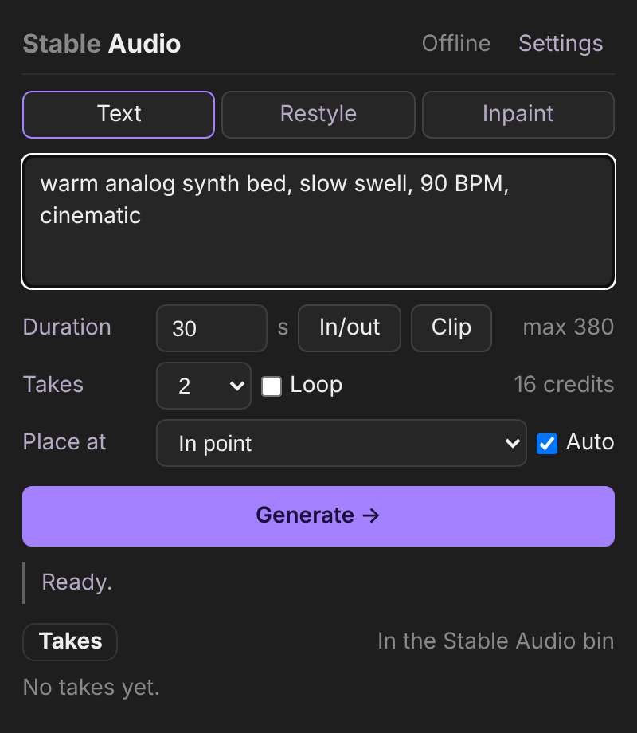

# Stable Audio for Premiere Pro

A Premiere Pro panel that generates music and sound design with Stable Audio 3 and places the result on your timeline.



## Try it

This is a UXP plugin, so there is no hosted demo; it runs inside Premiere Pro. Loading it takes about five minutes.

1. Premiere Pro 25.6 or later.
2. Install **UXP Developer Tools** from the Creative Cloud desktop app (v2.2.1 or later).
3. In UXP Developer Tools, turn on developer mode if asked, then **Add Plugin** and pick `manifest.json` in this folder.
4. Click **Load**. The panel appears under **Window > UXP Plugins > Stable Audio**.
5. Open **Settings** in the panel and paste a Stability API key (get one at https://platform.stability.ai/account/keys), then click **Save**. The key goes into UXP secure storage on your machine and is sent only to `api.stability.ai`.
6. Open a sequence, set in and out, type a prompt, click **Generate**.

Use **Debug** in UXP Developer Tools to see console output. Every status message is also logged with a `[StableAudio]` prefix. The **Sign in with Stability** button needs a broker service that is not hosted yet; see the sign-in section below for the local stub.

## What it does

Pick a mode (Text, Restyle, Inpaint), type a prompt, set the length from the sequence in/out or the selected clip, and generate one to four takes. Each take is imported into a "Stable Audio" bin and, with Auto on, placed on a new audio track at the in point or playhead as a single undo step. Restyle and Inpaint use the audio you select on the timeline as the reference: the panel renders the in/out range through Premiere's exporter (or cuts it straight from the clip's WAV) and sends it to the API. The header shows your credit balance and the cost of the run before you click.

- Text to audio, audio to audio (restyle a reference), and inpaint (regenerate a section)
- Reference audio is the in/out range you select on the timeline (rendered through Premiere's exporter with a WAV preset, or cut from the clip's WAV media), or a file
- Inpaint uses the selected clip as context and your in/out as the section to regenerate; "Extend to out point" fills a gap after a clip
- Duration from the sequence in/out range or the selected clip
- 1 to 4 takes per run, each imported into a "Stable Audio" bin
- One click places a take on a new audio track at the in point or playhead, as a single undo step
- Seamless loop toggle (prompt-level for now)
- Sign in with Stability (browser sign-in through a broker service, see below) or paste an API key; either way the key lives in UXP secure storage and the credit balance shows in the header
- Settings has Sign in with Stability, Get a key, Sign out (removes the key from this machine), and privacy and terms links; the browser-opening ones use the system browser, which UXP asks the user to allow once

## How it was built

Plain HTML, CSS and JavaScript in Adobe's UXP runtime, no framework and no build step; `index.html` is the panel, `index.js` is everything else (about 1,500 lines). Premiere's UXP API does the timeline work: `EncoderManager.exportSequence` to capture the reference range, `importFiles` into a bin, `createOverwriteItemAction` inside `executeTransaction` to place a take, all wrapped so a failing call reports what broke instead of hanging. Generated audio is written to the plugin's data folder with binary file writes. The Stability key lives in `uxp.storage.secureStorage`. A self-test harness (`selftest.js`) runs the Premiere-side calls from a request file so the integration can be checked without clicking and without spending credits. Styling follows the Stability brand tokens within what UXP can render. MIT licensed.

## How it uses Stable Audio

All three endpoints are async: the POST returns 202 with an `id`, and the panel polls `GET /v2beta/audio/results/{id}` every 3 s until it gets 200 with the audio bytes.

- **Text to Audio** (`POST /v2beta/audio/stable-audio/text-to-audio`): the Text mode. Prompt, `duration` from the timeline (up to 380 s), `output_format` wav or mp3, a random `seed` per take so takes differ, optional loop phrasing in the prompt.
- **Audio to Audio** (`POST /v2beta/audio/stable-audio/audio-to-audio`): the Restyle mode. The selected timeline range is sent as `audio` (6 to 380 s) with the prompt and `strength` (0.7 default; 0 keeps the input, 1 ignores it).
- **Inpaint** (`POST /v2beta/audio/stable-audio/inpaint`): the Inpaint mode and "Extend to out point". The selected clip is sent as `audio` for context, and in/out becomes `mask_start` / `mask_end`; extend puts the mask at the end of the clip and grows `duration` to the out point.
- **Balance** (`GET /v1/user/balance`): the credit figure in the header, refreshed after every run.

Model: `stable-audio-3` (default). Stable Audio 2.5 and 2.0 remain selectable in Settings and use the `/v2beta/audio/stable-audio-2/` path with a `model` field; they answer inline and cap at 190 s.

## Project structure

| Path | Role |
| --- | --- |
| `manifest.json` | UXP manifest: panel sizes, icons, `api.stability.ai` network permission, `fullAccess` file system. |
| `index.html` | The panel markup and all CSS. |
| `index.js` | Settings and secure storage, the Stability client (`CONFIG` and the "API" section), the Premiere integration (the "Premiere" section: capture, import, placement), takes list, sign-in flow. |
| `selftest.js` | In-panel test runner, inert unless `.selftest/DEV` exists and Test mode is on. |
| `tools/selftest.py` | Drives the self-test harness from a terminal and prints a report. |
| `tools/stub-broker.js`, `tools/stub-broker.test.js` | Local stand-in for the sign-in broker, and its test. |
| `tools/set-plugin-id.js`, `tools/make_icons.py` | Marketplace prep: switch the plugin ID, regenerate the icon set. |
| `icons/` | Panel and Marketplace icons. |
| `MARKETPLACE.md` | Checklist for packaging a `.ccx` and listing on the Creative Cloud Marketplace. |
| `docs/screenshot.png` | The image at the top of this README. |

## License

MIT, see [LICENSE](LICENSE).

## Sign in with Stability

A UXP panel cannot receive a browser redirect, so sign-in follows Adobe's `oauth-workflow-sample` pattern: the panel asks a broker service for a session, opens the broker's login page in the system browser, and polls the session until a key is attached.

1. **Sign in with Stability** (Settings > Account) does `POST {broker}/session` and gets `{ id, loginUrl }`.
2. The panel opens `loginUrl` with `uxp.shell.openExternal` and polls `GET {broker}/session/{id}` every 2 s. The status line counts down from 3:00; **Cancel** stops polling and leaves the panel as it was.
3. When the user finishes in the browser, the poll returns `{ status: "ready", apiKey }`. The broker hands the key out once and forgets it. The panel stores it through the normal settings path (so Sign out and the balance work as before), collapses Settings, and refreshes credits. The Account line reads "Signed in via Stability account"; a pasted key reads "Signed in (key ending ...)". The key issued by sign-in is never shown.
4. After 3 minutes without a result the panel shows "Login not completed" and an **Open sign-in page** link that reopens the same browser page and polls again (a new session is created if the broker's 10 minute session lifetime has passed). The paste-a-key field keeps working at every point.

Stability does not host the broker yet. `tools/stub-broker.js` stands in for it during development, and `CONFIG.broker` in `index.js` points at it:

```bash
node tools/stub-broker.js
```

It listens on `http://127.0.0.1:8787`, serves a one-button login page that issues a fake `sk-stub-...` key, and expires sessions after 10 minutes. The manifest change that allows this origin only takes effect after UXP Developer Tools reloads the plugin (Reload, or Remove and Add Plugin again if Reload keeps the old permissions). Every step logs a `[StableAudio] sign-in:` line in the Debug console, and a broker request that takes more than 10 s fails with a visible message instead of hanging. The fake key is rejected by `api.stability.ai`, so the header shows "Key rejected" after a stub sign-in; that is expected. Its test runs without Premiere:

```bash
node tools/stub-broker.test.js
```

Two manifest entries exist only for the stub and must go before packaging: `http://127.0.0.1:8787` under `requiredPermissions.network.domains` and `http` under `launchProcess.schemes` (UXP refuses to open a URL whose scheme is not listed). The real broker is an `https` origin, which also matters because macOS blocks plain `http` to anything but localhost. Switching to it is one line in `CONFIG.broker` plus the manifest domain. See `MARKETPLACE.md` for what the real service must expose.

## Self-test harness

`selftest.js` runs tests inside Premiere so an agent or a script can exercise the Premiere API without clicking. It is inert unless the plugin folder contains `.selftest/DEV` and Test mode is on in Settings.

```bash
python tools/selftest.py --enable        # creates .selftest/DEV; then Reload the plugin once
python tools/selftest.py                 # runs import, place, capture; prints a report
python tools/selftest.py env             # just describe the open project and sequence
python tools/selftest.py --disable
```

Keep a project with a sequence open in Premiere and turn on Watch in UXP Developer Tools so code changes reload on save. The runner writes `.selftest/request.json`, the panel polls it every two seconds, runs the named tests, and writes `.selftest/results.json` with per-test pass/fail, details, and the console lines from the run. Synthetic audio (a generated tone) stands in for the API, so the Premiere-side tests spend no credits; the Synthetic audio toggle in Settings does the same for manual Generate clicks.

Tests: `env` (project, sequence, tracks, in/out, selection), `import` (write a tone, import into the bin), `place` (set in/out, place at in point and playhead, verify clip counts), `capture` (find the placed clip, read its media and cut a range, check the length; also probes whether the selection API can be driven programmatically).

## Marketplace

`MARKETPLACE.md` is the checklist for packaging a `.ccx` and listing the plugin on the Creative Cloud Marketplace. Icons are generated by `python tools/make_icons.py`; the plugin ID is switched with `node tools/set-plugin-id.js`.

## Where files go

Generated audio is written to the plugin's data folder (`plugin-data:/takes`), which is a per-user folder Premiere manages. The project links to those files, so do not delete the folder while a project uses them. **Copy path** on a take copies the full path if you want to move it. A later version should write next to the project file or to a user-chosen folder (`localFileSystem: "fullAccess"` or a folder picker).

## Known risks (first-load checklist)

Verified by the self-test harness in Premiere 26 on 2026-10-23: timeline placement (overwrite on a new track, with the plain ProjectItem and Premiere's own TickTime), transactions, TickTime `.seconds`, bin creation, import lookup by name, selected clip times and media path, reading media from disk, binary writes, and WAV slicing. Still unverified in a real run: the export-preset capture path and the inpaint and extend window math.

These were the calls most likely to need a fix on first run. Each is isolated in `index.js` under the "Premiere" section.

| Area | What might break | Where to look |
| --- | --- | --- |
| Timeline placement | `createOverwriteItemAction(item, time, 0, audioTrackIndex)` argument order or whether `audioTrackIndex = trackCount` creates a new track. Fallback tries the last existing track. | `placeTake()` |
| Transactions | Actions must be created inside `executeTransaction`, which must run inside `lockedAccess`. The code does this; if it still fails, check the undo string and that the project item is a `ClipProjectItem`. | `placeTake()`, `stableAudioBin()` |
| TickTime | `tickSeconds()` reads `.seconds`, then `.ticksNumber`, then `.ticks`. If none exist, log the object and adjust. | `tickSeconds()` |
| Bin creation | `root.createBinAction(name, makeUnique)` is used. If it throws, takes land in the project root. | `stableAudioBin()` |
| Selected clip duration | `getSelection().getTrackItems()[0].getDuration()`. Pre-26.x builds may differ. | `selectedClipDuration()` |
| Import lookup | After `importFiles`, the item is found by name in the bin. If Premiere strips extensions differently, widen the match. | `importTake()` |
| Network | Only `https://api.stability.ai` and the sign-in broker origin are allowed in the manifest. A `TypeError: Failed to fetch` means the domain list, not the key. | `manifest.json` |
| Sign in with Stability | `uxp.shell.openExternal` needs the URL's scheme under `launchProcess.schemes`, and the user must accept UXP's consent prompt the first time. If the browser never opens, the panel says so and leaves an Open sign-in page link. | `signInWithStability()` |
| Selected clip as reference | `getSelection().getTrackItems()`, then `getStartTime` / `getInPoint` / `getProjectItem` on the track item and `getMediaFilePath` on the clip item. Each is wrapped; missing ones fall back or produce a clear message. | `selectedClipInfo()` |
| Reading media from disk | `fs.getEntryWithUrl("file:///...")` needs `fullAccess`. If it throws, check the manifest permission and the path separators (Windows paths are converted). | `readFileBytes()` |
| Binary writes | `file.write(arrayBuffer, { format: formats.binary })`. If the WAV is 0 bytes, check this call. | `writeTake()` |

## API notes

- Default model is **Stable Audio 3.0** on `POST /v2beta/audio/stable-audio/{text-to-audio|audio-to-audio|inpaint}`. These endpoints are async: the POST returns 202 with an `id`, and the panel polls `GET /v2beta/audio/results/{id}` every 3 s until it gets 200 with the audio bytes. Flat 8 credits per take, max 380 s, `steps` 4 to 8, `cfg_scale` default 1. Docs: https://docs.stability.ai/api-reference/stable-audio/text-to-audio.md
- Stable Audio 2.5 and 2.0 are still selectable. They use `/v2beta/audio/stable-audio-2/...` with a `model` field, answer inline, and cap at 190 s.
- Audio-to-audio sends the reference as `audio` (mp3 or wav, 6 to 380 s) plus `strength`: 0 keeps the input, 1 ignores it. The panel defaults to 0.7 for 3.0.
- Inpaint sends `audio`, `prompt`, `mask_start`, `mask_end` and `duration`. The docs do not spell out how `duration` beyond the source length behaves, so "extend" is a convention here (mask start = source length, duration = new total) until it is tested.
- Each take gets a random non-zero seed so takes differ.
- Rate limit is 150 requests per 10 s. Polling four takes at once stays far under it.

## Timeline reference (audio to audio and inpaint)

The reference is the audio you select in Premiere, captured one of two ways:

1. **With a WAV export preset set in Settings** (recommended): the panel sets the sequence in/out to the range it needs, calls `EncoderManager.exportSequence(..., ExportType.IMMEDIATELY, out, preset, false)`, restores your in/out, and reads the WAV back. You get exactly what you hear: mixes, effects, any media format. Make the preset once in File > Export > Media (Waveform Audio, Save Preset). Known Premiere issue: when the Work Area Bar is visible, the export uses the work area instead of in/out (Adobe bug DVAPR-4265965). Keep it hidden.
2. **Without a preset**: the panel reads the selected clip's media file (`ClipProjectItem.getMediaFilePath`, needs `localFileSystem: "fullAccess"`) and cuts the range out of it at the sample level. PCM WAV media only, and the range must sit inside one clip.

How each mode uses the range:

- **Audio to audio**: in/out is the reference and the duration (6 s minimum). The result is placed at the in point.
- **Inpaint**: select the clip and set in/out inside it. The whole clip (up to the model's max, centered on the selection when longer) is sent as context; in/out becomes `mask_start` / `mask_end` relative to that window. The result is placed at the window start so it lines up under the original.
- **Extend to out point**: set the out point past the end of the selected clip. The tail of the clip is the context, the mask starts at its end, and Duration grows to the out point.

**Place at: Reference range start** aligns the result with the range it came from. It is selected automatically after a timeline capture.

## Placement

`placeTake` tries, in order, overwrite on a new track, overwrite on the last track, then insert on the last track, and counts clips across audio tracks before and after each attempt so a silent no-op is reported as an error rather than a success. Auto-place is on by default.

## Visual style

Stability AI brand tokens: Studio Black `#1E1E1E` canvas, Black Obsidian `#262626` cards with `rgba(255,255,255,0.08)` hairlines, Canvas White `#EEEEEE` text, Desaturated Violet `#B6A9C6` labels, Grey Ash `#888888` hints. Artist Purple `#A381FF` appears only on the Generate pill, focus rings, and the active mode. 14px type floor, uppercase labels at +4% tracking, capsule section tags, no em dashes. Archivo is requested first and falls back to the system font because UXP cannot load web fonts.

## UXP layout notes

UXP ignores `display: block`, `<details>`, and does not show a `<select>` value unless an option carries `selected`. Every container in `index.html` is an explicit flex column, Settings toggles from JS, and the content is capped at 400 px wide so a wide floating panel stays readable. Dock the panel (drag its tab next to Project) to keep it narrow.

## Not in the prototype

- Extend as a first-class action (needs source-length detection and a replace-media step on the timeline)
- Audition inside the panel (UXP has no `<audio>` playback; takes are auditioned in the Source monitor)
- A real sign-in broker (the plugin side is done against `tools/stub-broker.js`; which account signs in and whose credits are spent is still an open product decision)
- Custom styles via Audio LoRA
- Writing files next to the project
